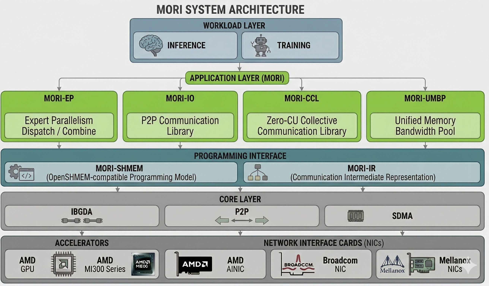

MORI Documentation
==================

**MORI** (**Mo**\dular **R**\DMA **I**\nterface) is a bottom-up, modular, and composable framework for building high-performance communication applications with a strong focus on RDMA + GPU integration.

New to MORI? :doc:`Install it <installation>`, then work through the :doc:`quickstart`.

.. toctree::
   :hidden:
   :caption: Getting Started

   installation
   quickstart

.. toctree::
   :hidden:
   :caption: MORI-EP

   User guide <MORI-EP-GUIDE>
   Choosing an API and backend <ep_backends>
   Benchmark <MORI-EP-BENCHMARK>
   RDMA bandwidth in the kernels <rdma_bandwidth_utilization>

.. toctree::
   :hidden:
   :caption: MORI-FUSED

   Guide <MORI-CCO-FUSED-OPS-GUIDE>
   GEMM + all-reduce / reduce-scatter <fused-gemm-ar>
   GEMM + all-to-all <fused-gemm-a2a>
   GEMM + all-gather <fused-gemm-ag>
   All-gather + GEMM <fused-ag-gemm>
   All-to-all + GEMM <fused-a2a-gemm>
   GEMM + all-gather benchmark <fused-gemm-ag-benchmark>

.. toctree::
   :hidden:
   :caption: MORI-SHMEM and MORI-IR

   SHMEM guide <MORI-SHMEM-GUIDE>
   IR guide <MORI-IR-GUIDE>

.. toctree::
   :hidden:
   :caption: MORI-CCO

   CCO guide <MORI-CCO-GUIDE>
   Device API for FlyDSL and Triton <cco-device-api>
   Examples <cco-examples>
   Benchmarks <cco-benchmarks>

.. toctree::
   :hidden:
   :caption: MORI-IO

   IO guide <MORI-IO-GUIDE>
   Benchmark <MORI-IO-BENCHMARK>

.. toctree::
   :hidden:
   :caption: MORI-UMBP

   Overview <umbp-overview>
   Configuration and environment variables <umbp-configuration>
   Pure-SSD mode and multi-drive tiers <umbp-pure-ssd-mode>
   NUMA placement for a DRAM tier <umbp-numa-tier-placement>
   KV indexer export <umbp-kv-indexer-export>
   Monitoring <umbp-monitoring>
   PD disaggregation benchmark <MORI-UMBP-PD-BENCHMARK>
   Tier-management benchmark <UMBP-TIER-MANAGEMENT-BENCHMARK>
   Simulation <umbp-simulation>
   Calibration <umbp-calibration>

.. toctree::
   :hidden:
   :caption: Tools

   MORI-VIZ kernel profiler <PROFILER>

.. toctree::
   :hidden:
   :caption: API Reference

   Communication APIs <api/communication>
   Profiler API <api/profiler>
   UMBP master client <api/umbp>

.. toctree::
   :hidden:
   :caption: Developer Guides

   JIT compilation framework <MORI_JIT_ARCHITECTURE>
   JIT v2 (in Chinese) <MORI_JIT_V2_DESIGN>
   UMBP single-node smoke test <MORI-UMBP-SINGLE-NODE-GUIDE>

Components
----------

.. list-table::
   :header-rows: 1
   :widths: 15 45 40

   * - Component
     - What it is
     - Start here
   * - **MORI-EP**
     - Intra and inter-node dispatch/combine kernels for MoE Expert Parallelism
     - :doc:`MORI-EP-GUIDE`, then :doc:`ep_backends` to choose between the original API and EPv2
   * - **MORI-FUSED**
     - GEMMs fused with the all-reduce, reduce-scatter, all-to-all or all-gather next to them, overlapping the transfer with the GEMM over the SDMA copy engines; built on MORI-CCO
     - :doc:`MORI-CCO-FUSED-OPS-GUIDE`
   * - **MORI-SHMEM**
     - OpenSHMEM-style symmetric memory APIs for GPU memory and RDMA
     - :doc:`MORI-SHMEM-GUIDE`
   * - **MORI-IR**
     - Device bitcode that lets Triton and other GPU kernel frameworks call the shmem and CCO device APIs
     - :doc:`MORI-IR-GUIDE`
   * - **MORI-CCO**
     - Collective Communication Object: explicit-handle GPU communication (LSA / GDA / SDMA)
     - :doc:`MORI-CCO-GUIDE`
   * - **MORI-IO**
     - Point-to-point communication library for KVCache transfer via RDMA/XGMI
     - :doc:`MORI-IO-GUIDE`
   * - **MORI-UMBP**
     - Unified memory and bandwidth pool with tiered storage and distributed KV access
     - :doc:`umbp-overview`
   * - **MORI-CCL**
     - Collective communication over the SDMA copy engines (``mori.ccl``: ``AllgatherSdma``, ``AllreduceSdma``, ``All2allSdma``, ``HierAllGather``, ``AllGatherIntoTensor``), built on MORI-SHMEM
     - No guide yet
   * - **MORI-VIZ**
     - Warp-level kernel profiler with Perfetto integration
     - :doc:`PROFILER`

Supported Hardware
------------------

**GPUs:** MI308X, MI300X, MI325X, MI355X (MI450X under development)

**NICs:** AMD Pollara (AINIC), Mellanox ConnectX-7, Broadcom Thor2 (Volcano under development)

Documentation versions
----------------------

The page title identifies an exact release tag or a development source commit.
Development documentation can describe features that are not in the latest
stable package. Check the `release notes <https://github.com/ROCm/mori/releases>`_
and the backend restrictions before choosing a deployment configuration.

Quick Links
-----------

* **GitHub**: https://github.com/ROCm/mori
* **Issues**: https://github.com/ROCm/mori/issues

Indices and tables
==================

* :ref:`genindex`
* :ref:`search`
