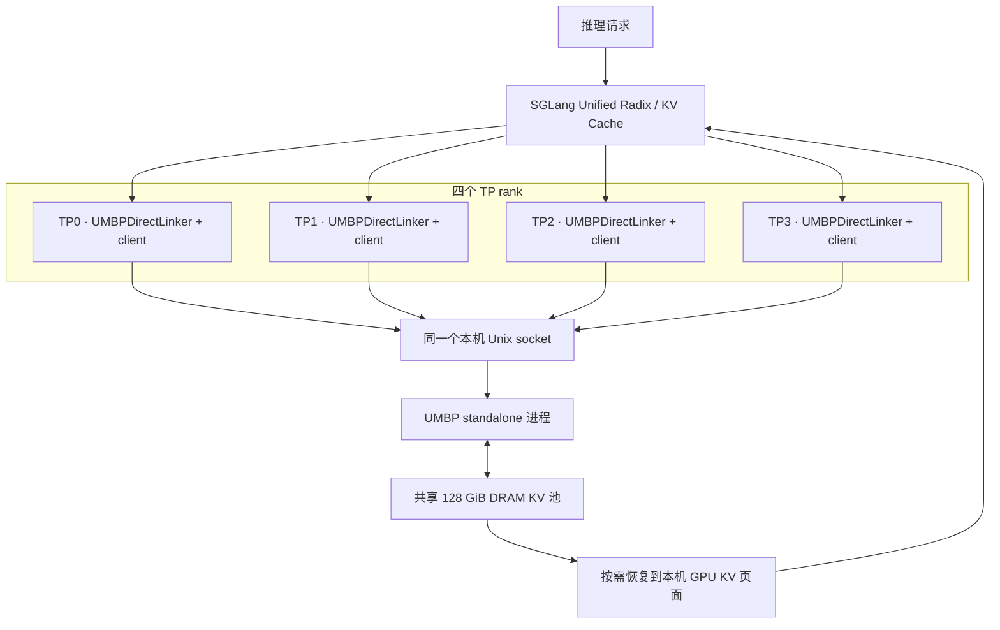

# SGLang 对接 Mori UMBP：MI455 单机 TP4 demo

本 demo 整理自 `inkcherry/MI455_inferencemax` 的 `repro/tp4-umbp-direct` 分支，
固定提交为
[`d26286ef2bf8b6cc14d1624aa19df550e7e28a66`](https://github.com/inkcherry/MI455_inferencemax/tree/d26286ef2bf8b6cc14d1624aa19df550e7e28a66/repro/tp4/umbp)。
它记录了 2026-10-16 在 f01-2 上进行的四卡 MI455/gfx1250、DeepSeek V4 Pro、
128 GiB host payload 实验，并提供启动与回放脚本。

## 1. 对接结构

该版本通过 SGLang **Unified Cache External Linker** 接入 Mori，后端选择 `mori`，
实例为 `UMBPDirectLinker`。四个 TP rank 的客户端连接同一个本机 standalone；
server 拥有统一 DRAM 池，Linker 负责框架页面和 UMBP 对象范围的转换。



图中 Unix socket 表示请求与元数据通路，payload 的地址访问需要注册和映射，
不能把 worker 中的裸指针直接交给另一个进程解引用。
本机 API 的 host/GPU 缓冲区要求见 [使用手册](user-guide.zh-CN.md)。

启动参数中的对接开关是：

```bash
--enable-unified-cache-external-linker \
--unified-cache-external-linker-backend mori \
--hicache-storage-backend-extra-config \
  '{"ssd_enabled":false,"standalone_auto_start":false}'
```

该配置使用 standalone DRAM，native HiCache 关闭。这个版本的 Direct Linker 也读取
`hicache-storage-backend-extra-config`，因此参数名称本身不能用于判定 HiCache L3 是否开启。
这些开关来自指定的 SGLang 集成快照，不能假定任意官方 SGLang 安装都有相同接口。

## 2. 固定软件版本与附件

| 组件 | 历史验证版本 |
|---|---|
| 本地镜像 | `yangwu/umbp-resume:20261015` |
| Image ID | `sha256:ebcc5f75093f1541c56b90f51f937d278fd2b6dfdfcebca63d16d3784c94002e` |
| SGLang | `943621c3364de6948fc02ee13c55b4f1cdf97f3a` 加 integrated 源码快照 |
| Mori | `879983bdbd8c65c52e9f79ad836a61cbffef98b6` |
| AITER | `a6d2b564fd671724a3720b8edf70e8d674e4d694` |
| PyTorch / HIP | `2.11.0+rocm10.0.0` / `7.15.26333` |
| 模型目录 | `/data2/models/DeepSeek-V4-Pro` |

镜像是历史本地镜像，不能假定公共 registry 可 pull。需要移交镜像、模型和以下附件：

```text
/home/yangwu/dsv4-tp4/umbp/attribution-ab-20261015/
  integrated/                 # 包含 sglang/，以及已测 mHC fn_transpose=True 修正
  source-manifest.json         # integrated 内逐文件 SHA256
/home/yangwu/dsv4-tp4/umbp/direct-equal-20261016/
  baseline-sync-v1/results/workload.json
/home/yangwu/dsv4-tp4/umbp/resume-20261015/ab/
  correctness-pre-workload.json
```

GitHub 分支不包含这些附件。本轮整理环境也没有上述历史附件，因此未在本轮重跑模型或硬件回放。
固定 Git HEAD 无法替代 integrated 快照。

历史 standalone 程序位于镜像内：

```text
/sgl-workspace/mori/python/mori/umbp_standalone_server
SHA256: 7a1eaff3d0c9ce4c4b8d1c853b888151d38666acac93a9d0b4f86f686dbc4c62
```

`run.py` 会检查 source manifest 和该二进制 hash。
测试当前 Mori 或另一版本 SGLang 时，需建立新的集成验证与版本记录；不能沿用本页历史性能结论。

## 3. 获取脚本与 CPU 预览

在主机执行以下命令，将脚本固定到指定版本：

```bash
export REPO_HOST_PATH="$HOME/MI455_inferencemax-umbp-demo"
git clone --branch repro/tp4-umbp-direct --single-branch \
  https://github.com/inkcherry/MI455_inferencemax.git "$REPO_HOST_PATH"
git -C "$REPO_HOST_PATH" checkout --detach \
  d26286ef2bf8b6cc14d1624aa19df550e7e28a66

python3 "$REPO_HOST_PATH/repro/tp4/umbp/run.py" umbp \
  --source /validated/integrated --out /runs/preview --dry-run
python3 -m pip install requests
python3 "$REPO_HOST_PATH/repro/tp4/umbp/test_recipe.py"
```

dry-run 不需要 GPU、模型或历史附件，不创建 output 目录，也不启动服务。
CPU recipe 检查需要 Python 环境安装 `requests`。
上述预览验证配置展开和脚本行为；实际部署仍需要下面的镜像和附件。

| 固定脚本 | 作用 |
|---|---|
| `run.py` | 环境清理、source/hash 校验、空闲窗口、standalone 启动、模型 readiness、容量验收、故障检查和子进程清理 |
| `launch-model.sh` | 实验模型参数；由 `run.py` 调用 |
| `probe.py` | GPU copy/compute 与有界 UMBP client readiness 探测 |
| `replay.py` | 168 请求的历史输入回放和 retrieval 验证 |
| `test_recipe.py` | 11 项 CPU recipe 检查 |

## 4. 准备运行环境

实际运行需要四卡 MI455、足够的模型与缓存内存，以及 Python 3.10+、Bash、`requests`、
`amd-smi`、可读的 dmesg、host PID 可见性、四个 GPU 的 sysfs 内存计数器。
128 GiB 指 DRAM payload，系统还要容纳模型加载、元数据、临时缓冲区和操作系统开销。

以下示例沿用历史路径。移交到另一台主机后修改这些宿主机路径；
`MORI_DOC_HOST_PATH` 指向含本组文档与请求示例的 Mori checkout。

```bash
export ARTIFACT_HOST_PATH=/home/yangwu/dsv4-tp4/umbp/attribution-ab-20261015
export INPUT_HOST_PATH=/data/umbp-tp4-inputs
export MODEL_HOST_PATH=/data2/models/DeepSeek-V4-Pro
export RUN_HOST_PATH=/data/umbp-tp4-runs
export MORI_DOC_HOST_PATH=/home/yangwu/mori
export TEST_IMAGE=yangwu/umbp-resume:20261015
export TEST_CONTAINER=umbp-tp4-$(date +%Y%m%d-%H%M%S)

mkdir -p "$INPUT_HOST_PATH" "$RUN_HOST_PATH"
cp /home/yangwu/dsv4-tp4/umbp/direct-equal-20261016/baseline-sync-v1/results/workload.json \
  "$INPUT_HOST_PATH/"
cp /home/yangwu/dsv4-tp4/umbp/resume-20261015/ab/correctness-pre-workload.json \
  "$INPUT_HOST_PATH/"

docker image inspect --format '{{.Id}}' "$TEST_IMAGE"
# 核对输出与版本表中的 Image ID 一致。
docker run -d --name "$TEST_CONTAINER" \
  --network host --ipc host --pid host --privileged \
  --device /dev/kfd --device /dev/dri \
  --security-opt seccomp=unconfined --security-opt label=disable \
  --ulimit core=0:0 \
  -v "$REPO_HOST_PATH:/repro:ro" \
  -v "$ARTIFACT_HOST_PATH:/validated:ro" \
  -v "$INPUT_HOST_PATH:/inputs:ro" \
  -v "$MODEL_HOST_PATH:/model/DeepSeek-V4-Pro:ro" \
  -v "$RUN_HOST_PATH:/runs" \
  -v "$MORI_DOC_HOST_PATH:/mori-docs:ro" \
  "$TEST_IMAGE" sleep infinity
```

容器设置来自历史诊断 recipe。`run.py` 默认等待连续 300 秒空闲，最多等待 30 分钟，
之后才运行探测和模型；若 `amd-smi` 返回 schema 与预期不同，guard 会报错。
这些检查用于该复现环境，输出目录必须是新目录。

## 5. 服务配置与两次请求 demo

固定模型配置如下：

| 项目 | 配置 |
|---|---|
| 并行方式 | TP4 / DP1 / EP1，CP 关闭 |
| attention / KV | BF16，`attention-backend=dsv4` |
| GPU KV 上限 | 65,536 tokens |
| token page / chunked prefill | 256 / 512 |
| 内存比例 / seed | 0.82 / 352644285 |
| 图与调度 | CUDA graphs 关闭，WAR barrier 开启，overlap scheduling 开启 |
| server 请求上限 | 130；回放并发为 2 |
| 默认执行模式 | `kernel_sync`：`AMD_SERIALIZE_KERNEL=3`、`HIP_LAUNCH_BLOCKING=1`，清除 `AMD_SERIALIZE_COPY` |

standalone 的配置由 `run.py` 设置：

```bash
UMBP_DRAM_CAPACITY=137438953472
UMBP_DRAM_USE_HUGEPAGES=0
UMBP_SSD_ENABLED=0
MORI_UMBP_LOG_LEVEL=INFO
```

supervisor 清除继承的 `UMBP_*` 环境变量，创建私有 socket，启动一个 standalone，
等待实际 client 连接，再将地址传给四个 SGLang rank。`standalone_auto_start=false` 避免 rank 各自启动服务。

启动服务并自动执行本仓库的两次请求示例：

```bash
docker exec "$TEST_CONTAINER" python3 /repro/repro/tp4/umbp/run.py umbp \
  --source /validated/integrated --manifest /validated/source-manifest.json \
  --out /runs/umbp-demo-v1 --execution kernel_sync --timeout 3600 \
  --client python3 /mori-docs/examples/umbp/sglang_linker_smoke.py \
    --out /runs/umbp-demo-v1/client
```

[sglang_linker_smoke.py](../../examples/umbp/sglang_linker_smoke.py) 先检查 `/get_server_info`
里的 Mori Linker 开关和 HiCache 状态，再向 `/generate` 发送两次相同 prompt。
示例保存完整 response、`cached_tokens_details` 与 `complete.json`，使用标准 Python 库。
`run.py` 通过 `UMBP_TEST_URL` 传入实际服务地址，client 成功后回收本次服务子进程。

两次小请求主要用于确认接入配置和 HTTP 推理能工作；第二次可能命中 GPU KV，
不能仅凭该请求证明发生 DRAM 恢复。验证 host 恢复使用下一节的 fill/replay。

如果希望交互式使用，省略 `--client` 及其参数，等待 `READY` 或 `ready.json` 后，
在同一主机另一终端运行：

```bash
python3 /home/yangwu/mori/examples/umbp/sglang_linker_smoke.py \
  --url http://127.0.0.1:18000 --out /data/umbp-tp4-runs/http-demo-v1
```

默认 HTTP port 为 18000，NCCL port 为 19500。
通过 `docker exec -e PORT=... -e NCCL_PORT=...` 可调整，模型路径和 served name 同样可用
`MODEL_PATH`、`SERVED_MODEL_NAME` 修改；其他参数保持固定 recipe。

## 6. 168 请求历史回放

使用新的 output 目录执行 UMBP 回放：

```bash
docker exec "$TEST_CONTAINER" python3 /repro/repro/tp4/umbp/run.py umbp \
  --source /validated/integrated --manifest /validated/source-manifest.json \
  --out /runs/umbp-sync-v1 --execution kernel_sync --timeout 3600 \
  --client python3 /repro/repro/tp4/umbp/replay.py \
    --workload /inputs/workload.json \
    --correctness /inputs/correctness-pre-workload.json \
    --out /runs/umbp-sync-v1/client
```

| 阶段 | 请求数 | 目的 |
|---|---:|---|
| cold retrieval | 4 | 首次生成与指定答案校验 |
| GPU-hit retrieval | 4 | 重用同一输入，重复答案校验 |
| 24 fill | 24 | 填充前缀 |
| 24 replay | 24 | 回放相同前缀并观察 host hit |
| 56 fill | 56 | 更大前缀集合 |
| 56 replay | 56 | 回放该集合 |

合计 168 请求、16 项 retrieval 答案检查。输入固定为 4,096 tokens，普通输出 32 tokens，
retrieval 输出至多 16 tokens，温度为 0，stage 间不执行 flush。
`replay.py` 验证输入 ID/hash，保存逐请求数据与阶段汇总。

需要 native HiCache 对照时，顺序执行下列命令：

```bash
docker exec "$TEST_CONTAINER" python3 /repro/repro/tp4/umbp/run.py hicache \
  --source /validated/integrated --manifest /validated/source-manifest.json \
  --out /runs/hicache-sync-v1 --execution kernel_sync --timeout 3600 \
  --client python3 /repro/repro/tp4/umbp/replay.py \
    --workload /inputs/workload.json \
    --correctness /inputs/correctness-pre-workload.json \
    --out /runs/hicache-sync-v1/client
```

两组使用相同模型、输入、dtype、GPU KV 预算、执行模式和 host payload。
Native 使用 `--hicache-ratio 58.7890625`、`write_through`、`page_first` 和 `kernel`；
该 SGLang 版本不支持 `--hicache-size`。
V4 每 rank 每逻辑页的 payload 为 `30*65536 + 30*8448 + 31*2048 = 2283008` 字节，
15,050 pages/rank × 4 为 137,437,081,600 字节，约 127.998257 GiB。
这个比较对齐的是 payload 容量；模型、TP、布局或 dtype 变化后要重新计算，不能直接复用 ratio。

`--execution async` 是另一种性能实验配置，不能引用同步回放的稳定性和性能结果。

## 7. 验收与日志

supervisor 会检查四个 rank 的实际接入，以及 standalone 真实分配。
UMBP 正确启动的关键日志包括每个 TP0..3 的：

```text
UMBPDirectLinker topology=StandaloneProcess+... ranged_io=yes rank_replicated=True suffix=cp0_pp0
Tree cache initialized: ... hicache_attached=False
```

standalone 应只有一个 DRAM payload pool，`total_bytes=137438953472`。
配置参数存在或 HTTP health 成功都不能替代这些验收。

| 运行文件 | 查看内容 |
|---|---|
| `runtime.json`、`source.json` | 启动配置与 source/hash 记录 |
| `server-info.json`、`capacity.json`、`ready.json` | 模型参数、实际缓存容量与服务地址 |
| `model.log`、`standalone.log`、probe 日志 | 各 rank attachment、pool 分配与探测 |
| `client.log`、`client/summary.json` | 请求状态、阶段耗时、cache token details |
| `client/complete.json` | 168 请求 / 16 retrieval 检查完成标志；两次请求 demo 为 2 请求 |
| `state.json`、ECC/进程/kernel snapshots | supervisor 结束状态和设备异常记录 |

历史回放验收需同时满足 168/168 响应、16/16 retrieval、完整 `complete.json` 和成功的 supervisor 状态。
`state.json.error=null` 表示 supervisor/client 完成，仍需检查 ECC 和 kernel snapshots。
`runtime.json` 记录启动环境，这版 portable supervisor 不验证运行中 worker 的 `libc.getenv`。

区分 `cached_tokens_details.device`、`host`、`storage`。
UMBP Direct 组的 `host` 表示 UMBP DRAM；native 组的 `host` 表示 HiCache DRAM。
报告 fill+replay 总体耗时和 replay 单独耗时，比较完整且配置一致的两组。

服务在 client 成功、故障、争用或 timeout 时结束。
supervisor 只清理本次子进程，不停止 enclosing container；完成后停止本次专用容器并查看设备状态：

```bash
docker stop "$TEST_CONTAINER"
amd-smi process --json
amd-smi metric --ecc --mem-usage --json
```

## 8. 历史结果与适用结论

以下数字来自固定分支 README 记录的 2026-10-16 同步 A/B 实验，本轮未重测：

| 阶段 | Native HiCache wall (s) | UMBP Direct wall (s) | 输出 token/s：Native → Direct |
|---|---:|---:|---:|
| 24 fill | 213.722 | 210.520 | 3.322 → 3.373 |
| 24 replay | 111.019 | 107.298 | 6.395 → 6.617 |
| 56 fill | 515.115 | 511.031 | 3.366 → 3.393 |
| 56 replay | 265.588 | 258.757 | 6.529 → 6.701 |

两组 host replay 都命中 24/24 和 56/56 前缀；56 个前缀可装入池，未压满 128 GiB。
replay 吞吐提升为 3.47% / 2.64%，四个主要阶段合计约 1.0164×。
这是一对同步样本，尚不能据此承诺稳定性能提升。

两组均通过 168 响应和 16 retrieval，但生成文本仅 46/168 完全一致；
该记录支持接入、缓存恢复与指定 retrieval 检查通过，不能视为完整数值等价证明。
其他尝试还记录了 GPU2 fault，根因和正常异步稳定性仍未解决。

分支 2026-10-20 的长上下文 AgentX 诊断将 GPU KV 增至 4,194,304 tokens、
chunked prefill 调至 16,384，DRAM 仍为 128 GiB；
fused mHC 和随后 sparse attention prefill 发生 fault，未进入正式测量。
它没有完整性能结果，不作为本 demo 的成功基线。

## 9. 来源与本轮验证范围

- [固定版 UMBP README](https://github.com/inkcherry/MI455_inferencemax/blob/d26286ef2bf8b6cc14d1624aa19df550e7e28a66/repro/tp4/umbp/README.md)：环境、附件、128 GiB 对照和历史结果。
- [固定版 run.py](https://github.com/inkcherry/MI455_inferencemax/blob/d26286ef2bf8b6cc14d1624aa19df550e7e28a66/repro/tp4/umbp/run.py)：启动与验收逻辑。
- [固定版 launch-model.sh](https://github.com/inkcherry/MI455_inferencemax/blob/d26286ef2bf8b6cc14d1624aa19df550e7e28a66/repro/tp4/umbp/launch-model.sh)：完整模型参数。
- [固定版 replay.py](https://github.com/inkcherry/MI455_inferencemax/blob/d26286ef2bf8b6cc14d1624aa19df550e7e28a66/repro/tp4/umbp/replay.py)：168 请求输入与结果检查。

2026-11-10 文档整理时完成以下验证：

| 验证项 | 结果与边界 |
|---|---|
| 固定版 `test_recipe.py` | 11 项 CPU 检查通过 |
| 固定版 `run.py --dry-run` | 配置展开成功，无模型或服务启动 |
| 本仓库 `local_kv_demo.py` | 当前编译的 `libmori_umbp_pybinds.so` 下，4 MiB DRAM、64 MiB SSD 和 64 MiB standalone DRAM 均通过 4 个对象的读写、batch/range 与字节校验；使用独立扩展加载验证，未重新构建完整 Python 安装包 |
| 本仓库 `sglang_linker_smoke.py` | 本机模拟 HTTP 服务验证两次相同请求、错误后端拒绝、abort / HTTP 错误处理及已有 output 拒绝；未连接真实模型 |
| 文档与脚本 | 本地链接、Python 语法和格式检查通过 |

真实 SGLang 模型启动和 MI455 回放需上述完整附件与硬件环境。
