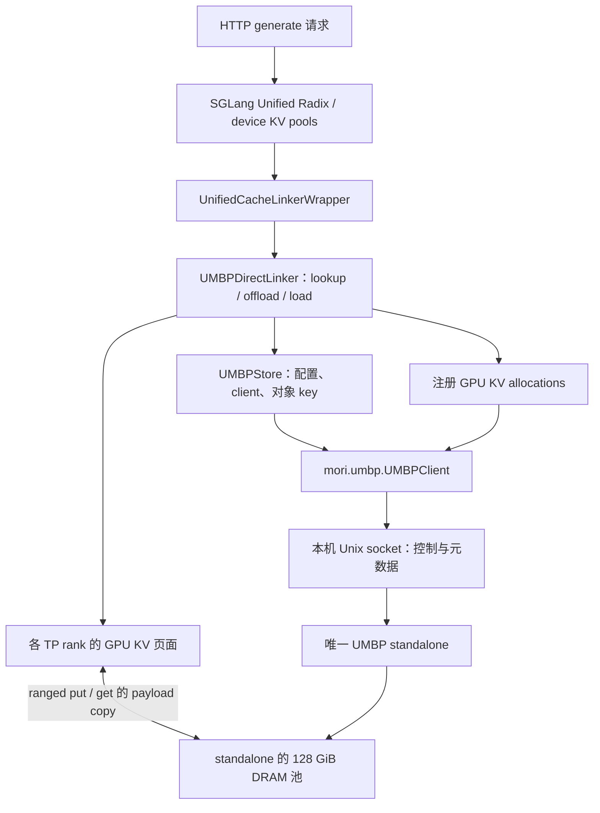
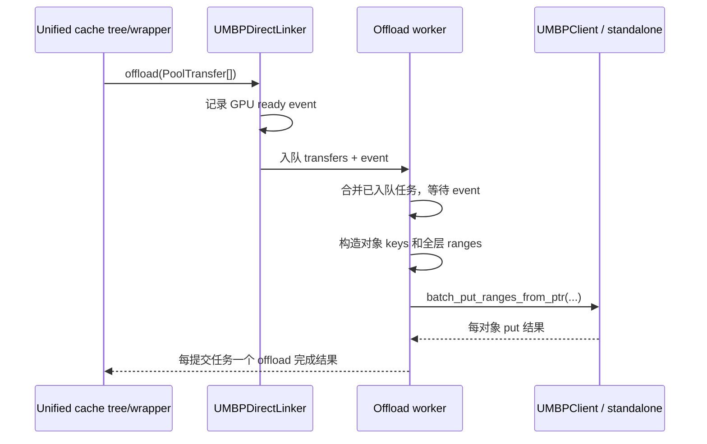

# SGLang 对接 Mori UMBP：代码导读

实际接入代码是 `UMBPDirectLinker` 和它持有的 `UMBPStore`。
本分支保存了公开基础镜像中的固定源码，方便同事在 GitHub 上直接阅读；
完整运行依赖和框架调用方由 [构建镜像](sglang-build.zh-CN.md) 提供。
HTTP demo 用于验证这条链路，框架适配逻辑在以下 reference 文件中。

| 学习顺序 | 文件 | 重点 |
|---|---|---|
| 1 | [UnifiedCacheLinker](../../examples/umbp/sglang/reference/unified_cache_linker.py) | 框架与外部 KV 缓存之间的接口约定，以及 wrapper 如何消费完成状态 |
| 2 | [UMBPDirectLinker](../../examples/umbp/sglang/reference/umbp_direct_linker.py) | 页面布局、key、GPU 内存注册、lookup/offload/load、分层完成通知 |
| 3 | [UMBPStore](../../examples/umbp/sglang/reference/umbp_store.py) | 加载 `mori.umbp`、生成配置、连接 standalone、构造 client 和 key namespace |
| 4 | [固定模型 launcher](../../examples/umbp/sglang/recipe/launch-model.sh) | 启用 unified cache external linker 并选择 Mori |
| 5 | [supervisor](../../examples/umbp/sglang/recipe/run.py) | 启动唯一 standalone、传递 socket、验证四个 rank 和 128 GiB 池、管理生命周期 |
| 6 | [HTTP smoke](../../examples/umbp/sglang_linker_smoke.py) / [fill/replay](../../examples/umbp/sglang/fill_replay.py) | 接入参数检查、推理响应检查、DRAM restore 验收与结果保存 |

`reference/` 的三个 Python 文件保持原始内容，来源路径和 SHA256 见
[reference/source.json](../../examples/umbp/sglang/reference/source.json)，许可证见
[reference/LICENSE](../../examples/umbp/sglang/reference/LICENSE)。
它们用于阅读，不是一个可独立 `pip install` 的 SGLang 包。修改 reference 不会自动替换运行中的代码；
默认构建会检查它与基础镜像源码一致。运行源码使用镜像内生成的 `integrated/sglang/`。

## 1. 接入结构



四个 TP rank 各有 Linker/client，连接同一个 standalone。后者持有 DRAM pool。
Unix socket 传输操作和地址描述；GPU allocation 必须先注册，跨进程使用映射与句柄，
不能把一个进程的裸 GPU 指针交给另一个进程直接解引用。
Linker 直接用 GPU KV buffer 构造 ranges，payload 复制和完成同步由 Mori 实现。
这里的 Direct 避免框架另建完整的 native HiCache host pool；GPU/DRAM 之间仍然需要搬运数据。

## 2. 初始化：先统一布局，再创建 client

从 `UMBPDirectLinker.__init__` 开始读：

1. `resolve_hybrid_device_pool_group` 解析 KV/辅助 pool 的 components、layers、page layout；
   `_ordered_layers` 检查 logical layer 到实际 buffer 的映射。
2. 读取 `hicache_storage_backend_extra_config`，构造 `HiCacheStorageConfig` 和 `UMBPStore`。
   本版本 Direct 配置明确要求 `ssd_enabled=false`。
3. `UMBPStore.__init__` 调用 `UMBPConfig.from_environment()`，读取
   `UMBP_STANDALONE_ADDRESS`，设置 `UMBPStandaloneProcessConfig`，再构造 `UMBPClient(cfg)`。
4. Linker 检查 `client.supports_ranged_io()`，确认可执行多 buffer/range I/O。
5. `_register_buffers` 按 allocation 的 `data_ptr()`/`nbytes()` 注册 GPU KV 内存，
   同一 allocation 的多个 tensor view 只注册一次。
6. 创建 load/offload 线程、工作队列和 `LayerWiseLoadCounter`。

supervisor 先启动唯一 standalone，再传递私有地址；模型参数设置
`standalone_auto_start=false`，避免四个 rank 各自创建 server。
日志中的 `topology=StandaloneProcess+... ranged_io=yes` 表示实际模式和能力。

## 3. 对象 key 和 byte ranges 如何对应 KV 页面

`_object_keys_for_pages` 将框架逻辑 page keys 转成 UMBP object keys。
packed pool 通常一页对应一个对象，非 packed pool 一页可对应多个 component 对象。
同一个对象保存该页的所有 layers，恢复某些 layers 时读取对象内的 byte ranges。

| 字段 | 含义 |
|---|---|
| `keys` | UMBP 对象名称，由页 key、pool/component 和 namespace 生成 |
| `object_sizes` | put 时完整对象的长度，按 pool layout 计算 |
| `ptrs` | 本进程目标/源 GPU KV buffer 中各 range 的起始地址 |
| `sizes` | 每段实际复制的字节数 |
| `offsets` | 各段在完整 UMBP 对象中的位置 |

例如一页的逻辑对象含 L0/L1 两层，GPU 中两层不连续：

```text
UMBP object "page-X": [ L0 bytes ][ L1 bytes ]
GPU source ranges:   ptr-L0, ptr-L1
sizes:               [size-L0, size-L1]
offsets:             [0, size-L0]
object_size:         size-L0 + size-L1
```

写入时一次对象 put 通过 ranges 组装该页；读回 L1 只需读取对象的 `[size-L0, size-L0+size-L1)`。
实际 V4 还有不同 KV/辅助 pools，不能假设所有 pool 的 layer 数或 component 数相同。
`_build_load_plans`、`_all_layer_ranges` 和 `_layer_group_ranges` 负责从实际布局生成这些描述。

`_storage_suffix` 对 `rank_replicated=True` 的池省略 TP suffix，避免同一逻辑页占用四个不同 key；
非复制池带 TP suffix，CP/PP suffix 保留。此版本仍由每个 rank 写入，不是只让 TP0 写。
移植到新模型时，需要先核对 replicated 语义和 namespace，避免错误共享不同内容。

## 4. offload：GPU KV 写入 DRAM



读 `offload` → `_take_offload_batch` → `_run_offload`。
ready event 保证源 KV 写入完成；offload 结果通知前，调用方必须保留相关 GPU 页面。
对象 ranges 必须完整覆盖对象，RPC 分批边界只能在对象之间。
任一对象失败，该批任务不会报告成功，tree 根据完成结果决定能否依赖外部副本。

## 5. lookup 和 load：恢复到 GPU

`lookup` 是查询，不复制 KV：它通过 `batch_exists` 检查所有相关 pools，
按 `ALL_PAGES`/`TRAILING_PAGES` hit policy 返回可完整恢复的 prefix boundaries。
框架会跨 rank 求交集；只返回“本 rank 最长命中”可能选中其他 rank 无法恢复的边界。

`load` 将目标 ranges 保存到 pending；下一次 `start_layer_wise_loading` 才真正启动传输：

1. 批量构造 load plans，记录 GPU ready event，把 plans 交给 load worker。
2. worker 按 layer group 调用 `batch_get_ranges_into_ptr`，目标指向 GPU KV slots。
3. 该组所有 pool/range 成功后，再标记对应 layers 完成。
4. 框架通过 `LayerWiseLoadCounter.wait_until` 等待可读层，避免使用未填好的 GPU slots。

此流程支持 dedup 后只剩辅助 pool 的 partial transfer。排队后的 tree node 已可见，
`cancel_queued_load` 因而返回 false，不能简单取消并留下尚未恢复的数据。

## 6. 性能参数和生命周期

| 代码点 | 默认值与作用 |
|---|---|
| `UMBP_LAYER_GROUP` | 8；多层合并减少对象/RPC 重复描述，增大后会降低逐层释放的粒度 |
| `UMBP_OFFLOAD_COALESCE_PAGES` | 1024；只合并队列里已有任务，减少小对象请求次数，不等待尚未提交任务 |
| `UMBP_RANGES_PER_CALL` | 8192；按实际 ranges 数限制控制消息，packed 多 component 也计入预算 |
| `_layer_group_ranges` | 用 NumPy 的数组运算生成地址，复用不随 page 改变的 size/offset，减少 Python 热路径开销 |
| `_materialize_offload_indices` | 使用异步 index snapshot/pinned buffer，降低重复 GPU→CPU 索引转换成本 |

这些是 Linker 源码的默认值。固定 supervisor 会清除继承的 `UMBP_*` 变量；
不能只在宿主机 `export UMBP_LAYER_GROUP=...` 就假定它进入模型进程。
调整实验参数时，要在单独的 recipe 修改中显式传入，并记录新配置和结果。
`UMBP_LOAD_SPLIT` 被本版本明确拒绝，避免 dedup 后 rank page 集合不同导致等待问题。

`reset` 等待 load/offload 队列完成再清理状态；`close` 停止 worker，
standalone 模式先注销注册内存，再关闭 store。GPU tensor 生命周期必须覆盖排队操作和注销完成。
新适配不能把 `load/offload` 的排队成功误当成复制完成。

学习后按 [构建与运行文档](sglang-build.zh-CN.md) 执行 `check`、`preview`、`smoke` 和 `fill-replay`。
成功的 HTTP 响应、四个 rank attachment、实际 DRAM pool，以及 replay host hit 分别提供不同证据，
结合它们才能确认端到端接入与恢复。
