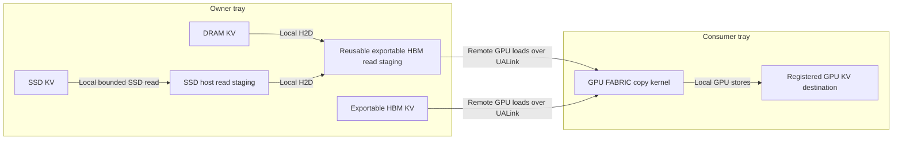

# UMBP KV sharing over UALink

This implementation extends UMBP's existing `MoriIoEngine` with MORI-IO's
FABRIC backend. It does not introduce a second UMBP remote transfer engine.
The control plane remains gRPC; KV payloads are pulled from owner-local,
fabric-exportable HBM into registered ranges on the consumer's GPU. HBM KV is
read directly. DRAM and SSD KV use a bounded owner HBM read-staging arena while
keeping their original storage tier and key ownership.

## Supported first version

* Producer-local, immutable KV objects in UMBP-owned HBM, DRAM or SSD storage.
  DRAM/SSD owners explicitly enable an exportable HBM read-staging arena.
* Consumer pulls a whole object or selected, possibly noncontiguous byte ranges.
  GPU direct ranges can belong to different registered allocations.
* Strict FABRIC operation for all three tiers. Automatic selection continues
  to choose FABRIC/RDMA from the original endpoints; it does not request the
  cold-tier HBM bridge. RDMA remains the default for existing callers.
* Completion pins, protected pending writes, owner incarnation and pool
  generation checks, idempotent control-plane operations, and explicit GPU fault
  quarantine.
* A genuine multi-segment FABRIC copy kernel, contiguous segment coalescing,
  reusable mapping/descriptor caches, asynchronous D2D copies for local KV PUT,
  and independent asynchronous GPU read groups with inflight limits.

Native inference-owned KV export and remote-attention kernels are separate
features. This version copies producer KV into the UMBP pool and copies remote
KV into consumer inference memory. It does not provide a model-specific inference
connector, consumer-side packed staging, or a layer scheduling policy.

## Transport and pool configuration

The following settings are available as C++/Python configuration fields and
as environment variables. Set environment variables before creating the config.

| Environment variable | Values / default | Meaning |
| --- | --- | --- |
| `UMBP_TRANSFER_MODE` | `rdma` (default), `auto`, `fabric_strict` | MORI-IO backend selection |
| `UMBP_FABRIC_KERNEL_PATH` | path to `fabric_copy.hsaco` | Required for strict FABRIC |
| `UMBP_HBM_ALLOCATION` | `hip` (default), `fabric_vmm` | HBM allocation/export mechanism |
| `UMBP_KV_PUT_PLACEMENT` | `master` (default), `owner_local` | Producer placement |
| `UMBP_KV_RANGED_PATH` | `legacy` (default), `gpu_direct` | Consumer destination path |
| `UMBP_KV_MAX_INFLIGHT_READS` | `32` | Concurrent admitted read groups |
| `UMBP_KV_MAX_INFLIGHT_BYTES` | `268435456` | Requested destination bytes plus logically pinned source bytes |
| `UMBP_FABRIC_READ_STAGING_BYTES` | `0` (disabled) | Owner HBM capacity reserved for transient DRAM/SSD reads; positive multiples of the pool page size |
| `UMBP_FABRIC_READ_STAGING_DEVICE` | `0` | Owner GPU that exports the read-staging arena |

Configure HBM owners with `hbm.device` and `hbm.capacity_bytes` appropriate
for the local GPU (the internal pool config uses `hbm.buffer_sizes`). DRAM/SSD
owners keep their storage configuration and set `fabric_read_staging_bytes` and
`fabric_read_staging_device` in the distributed config. The byte budget allocates
one arena at initialization; it is not storage placement capacity. Strict mode
verifies that advertised HBM pools export fabric handles. A consumer's local
destination may be an ordinary `hipMalloc` allocation;
only the remote source must be fabric-exportable. A consumer does not have to
advertise a nonempty HBM pool. Strict mode rejects a CPU endpoint, missing fabric
capability, mismatched domains, or unavailable copy module. Cold-tier reads
require the owner's configured bridge; strict mode never switches their payload
to RDMA. The arena can be enabled on an `auto` owner to serve strict consumers,
but an `auto` consumer continues to use the original cold-tier endpoint.

`auto` uses actual endpoint capability and backend eligibility. An optional
RDMA registration failure can leave a valid FABRIC-only GPU region. Selective
registration records its capabilities in the memory descriptor, so a backend
cannot claim an unregistered endpoint.

GPU direct GET does not allocate a host GET scratch arena. If
`distributed.ranged_scratch_size` is explicitly positive, the client retains a
PUT arena for the existing remote ranged-write assembly path, including its
NUMA/hugepage configuration. Producer-local PUT and GPU direct GET need no such
arena. Direct remote scatter PUT over FABRIC is not part of this version.

Build the module for the GPU architecture detected by CMake:

```bash
cmake --build build-ualink --target mori_fabric_copy_kernel
export UMBP_FABRIC_KERNEL_PATH="$PWD/build-ualink/src/io/fabric_copy.hsaco"
```

Both GPUs must be in a compatible PPOD/VPOD and a fabric READY domain. gRPC
addresses must be reachable between hosts. UALink availability is checked by
the FABRIC backend, independently of a successful gRPC connection.

## DRAM and SSD read paths



The installed ROCr API supports Fabric export for GPU-agent allocations. Local
Host/HostNuma VMM probes accepted allocation, mapping and local copies but
returned `hipErrorInvalidValue` for Fabric export; Device VMM export/import
succeeded. See [the capability evidence](ualink-host-memory-capability.md).
This implementation therefore uses the explicit HBM bridge for cold tiers.

The consumer sends an object-relative read window in the completion-pin acquire
RPC. For scattered ranges, this is the smallest continuous envelope covering
the ranges. SSD extent staging reads that envelope when enabled and supported;
otherwise it reads the whole object before the HBM bridge copies the envelope.
The reply preserves the complete object size and storage tier, and identifies
the covered window and temporary HBM pages separately. The consumer copies
only its requested ranges into its registered GPU allocation. Holes inside the
envelope add SSD/H2D bytes without adding requested UALink copy bytes.

The HBM arena is allocated, registered and advertised once, allowing descriptor
and Fabric mapping reuse. Its dedicated wire backend ID is outside the storage
registry; it never publishes a key, participates in placement, or creates a
consumer-local UMBP replica. Source buffer references are reused within a batch,
and transfers use the existing local H2D and MORI-IO FABRIC engines.

All cold entries in a grant reserve HBM pages together. A batch that can never
fit returns `FAILED`; temporary occupation by outstanding grants returns
`BUSY`, with bounded client retry. SSD completion-pinned resolves also reserve
their host staging batch together, avoiding partial-batch retry starvation.
Size both arenas for the sum of rounded-up windows in a batch plus concurrent
reads, or submit smaller groups. Arena pressure is exposed as a failed read
after the retry budget, so callers can choose recomputation or a smaller group.

Owner DRAM/SSD source holds survive until the local H2D handle confirms
completion. The grant then holds the HBM staging pages until the consumer's
remote GPU copy completes and releases its pin. Slow SSD I/O and H2D preparation
run outside the read receipt mutex; retries of the same operation share one
preparation, while other releases can proceed. Clear/abandon cancel preparation
publication without freeing memory still used by a local copy. An unconfirmed
local or remote drain quarantines the corresponding backing and registrations.

## GPU range API and completion contract

Register stable allocation bases once, then reuse the registrations. C++ callers
can use `MemoryRegistration::kFabricLocal` for a local GPU destination without
creating an RDMA MR. A previous `kLocalCopyOnly` declaration can be upgraded at
the same base. GPU direct fails an unregistered or out-of-bounds destination.

```cpp
client.RegisterMemory(kv_base, kv_capacity, mori::io::MemoryLocationType::GPU,
                      gpu, MemoryRegistration::kFabricLocal);
auto read = client.SubmitBatchGetRangesGpuDirect(
    keys, destination_ranges, range_sizes, object_offsets);
if (!read->WaitOnStream(reinterpret_cast<void*>(inference_stream))) {
  auto ready = read->Wait();
  // Apply the request's cache-hit / recompute policy to ready before consuming KV.
} else {
  // Enqueue inference that consumes this group's ranges on inference_stream.
}
auto ready = read->Wait();  // also retires the owner's read pins
```

`BatchGetRanges` uses the same path synchronously when `gpu_direct` is configured.
Python distributed clients expose `submit_batch_get_ranges_gpu_direct`, returning
`KvReadHandle` with `wait()`, `wait_on_stream(stream_ptr)` and
`resources_quarantined`. Each handle represents one independently consumable
range group; callers can schedule layer groups separately.
Read handles can be completed or destroyed on a different thread from the
submitting thread. Counted state leases cover asynchronous resources through
retirement; preparation locks remain within the submitting call.
Python `client.close()` drains outstanding embedded read handles before releasing
pool resources; it is idempotent. Check `has_quarantined_transfers` afterward
before releasing caller-owned GPU allocations on an error path.

Keep destination allocations alive until `Wait` completes. A successful stream
wait queues dependencies; it is not a host-side success result and does not release
pins. A false stream-wait result requires host `Wait` and inspection of all key
results before consuming any failed key. Do not write or reuse an inference
range while its copy or dependent inference is running. Overlapping destinations
within one group, and overlapping outstanding GPU read groups, are rejected
before submission. Admission is nonblocking: exceeding the read/byte limits
returns failed results, allowing the caller to choose its fallback policy.

PUT requires source bytes to be ready before entry; synchronize the producer's
own stream/event before calling PUT. The synchronous PUT API returns after copy
completion and commit. Source readiness is a caller contract, not an implicit
whole-device synchronization on the hot path.

Standalone distributed mode registers imported GPU IPC ranges for local FABRIC
use without RDMA registration. Registration carries the physical GPU UUID so
worker and server device-ordinal orderings can differ. Its ranged RPC is
synchronous: the response follows destination completion. Asynchronous stream
handles are currently available in embedded distributed mode. A raw HIP stream
or event pointer is never transmitted through gRPC.

## Reclamation and restart behavior

A new peer advertises the completion-pin protocol with its incarnation and pool
generation. Each remote read first acquires a batch grant holding all resolved
source objects. The client owns this grant immediately, before decode, planning,
or submission; build/rejection paths release it. A fixed read lease is not used
to authorize reclamation of these pages. BUSY grants are released before a new
operation is issued.

The owner reserves and publishes receipts under short locks. Storage resolution
and H2D preparation run outside those locks. Duplicate acquires wait for the
same preparation result; Clear and abandonment prevent a cancelled preparation
from publishing a new grant. High fan-in receipt-table contention should still
be measured before adding shards or deferred release batching.

FABRIC/auto remote writes reserve protected slots identified by operation ID. Local
FABRIC-mode PUTs use the same protected lifecycle. A protected pending slot is
not TTL-reaped or freed by legacy abort/commit. Successful commit and failure
abort require confirmed transfer completion. Clear advances the generation but
retains old protected writes and active read holds until retirement. Old read
pin tokens may be released after Clear within the same owner incarnation.
The default RDMA write path retains its legacy allocation/commit protocol,
including remote SSD staging; advertising read-pin support alone does not opt
an SSD backend into protected writes.

Client operation IDs carry an incarnation and a monotonic sequence. Owner-side
watermarks compact terminal receipts without limiting a process to a fixed
number of KV operations. Active grants remain idempotent. The latest completed
write batch's receipts are retained for immediate retry; a replay older than a
newer completed batch can fail closed. An uncertain acquire/reserve reply is
retried using the same ID. If no GPU work was submitted, explicit operation
abandonment prevents a delayed RPC from allocating or pinning memory later.
If the owner remains unreachable, it conservatively retains unresolved resources.

Epoch disagreement fails the operation and invalidates remote descriptor caches.
A subsequent handshake imports the new incarnation/generation. In-flight imports
and sessions retain shared ownership even after cache invalidation. Epoch checks
cannot fence a GPU that is still executing old work.

If GPU completion/drain cannot be established, the operation reports quarantine.
The client retains owner pins, protected slots, registrations and relevant pool
backing instead of recycling them. `HasQuarantinedTransfers()` /
`has_quarantined_transfers` exposes this condition. Caller allocations must also
be retained. Standalone IPC mappings and owned scratch are retained on this path.
If submission throws after work may have been posted without a returned handle,
the same conservative quarantine applies; callers must check the client flag
before freeing source or destination allocations after an exception.
Recovery from a device fault requires an external device/process fencing policy;
a timeout, lost heartbeat or changed epoch alone does not prove the GPU stopped.
These guarantees cover paged DRAM/HBM backing and the host/HBM staging used by
cold-tier reads. SSD shutdown retains its host arena and registration while
completion holds or uncertain GPU work remain. Remote protected allocation
still fails closed for unsupported backends, including SSD; cold-tier sharing
uses committed owner-local objects, not a new remote SSD write protocol.

## KV identity and inference integration

UMBP stores opaque immutable objects. The application must use a namespace/key
that includes model/checkpoint, adapter, positional encoding, KV dtype/layout,
TP/PP/rank placement and prefix-chain identity. Token hashes alone do not prove
that two consumers can interpret the same KV bytes. Existing `KvBlockMetadata`
and external directory entries are advisory metadata; an external placement
announcement alone is not a servable UMBP object.

An inference connector should register allocations at startup, establish producer
readiness, agree on rank-level hit/fallback decisions, and consume a layer group
only after its destination completion. Model-level TTFT/TPOT validation requires
that connector and workload; this implementation's byte tests do not establish
model-level performance.

## Validation and measurement

The manual `umbp_ualink_kv_driver` runs master, producer and consumer as distinct
processes and supports reachable host addresses. For example, using the same
binary/module build on both hosts:

```bash
# Reachable master host, e.g. f01-1
umbp_ualink_kv_driver --role master --master F01_1_IP:50091 --duration-sec 300
# Producer on f01-1
umbp_ualink_kv_driver --role producer --master F01_1_IP:50091 \
  --advertise F01_1_IP --node-id f01-1 --run-id kv-test \
  --kernel /path/fabric_copy.hsaco --device 0 --duration-sec 300
# Consumer on f01-2
umbp_ualink_kv_driver --role consumer --master F01_1_IP:50091 \
  --advertise F01_2_IP --node-id f01-2 --expected-owner f01-1 --run-id kv-test \
  --kernel /path/fabric_copy.hsaco --device 0 --iterations 100
```

See `--help` for object/page/batch geometry, `--layout aligned|unaligned`, and
cold-import repetition. Use aligned ranges when measuring the vector-copy path,
and unaligned ranges to verify arbitrary layout correctness. The driver
asserts ownership, absence of a consumer-local replica, byte correctness, stream
ordering and actual selected FABRIC transport counters. Cold first-read and warm
latencies are separate. GET latency includes route lookup, acquire RPC,
planning, submission, completion wait and pin-release RPC. Reported bandwidth
uses requested bytes and this end-to-end GET time. The
`selected_fabric_submitted_bytes` counter measures submitted plans; successful
completion and byte verification accompany it. Neither measurement isolates
kernel time or physical link traffic. Cold samples measure the first GET after
client reconstruction; reconstruction itself occurs outside the GET timer.

For DRAM, add `--medium dram --fabric-staging-bytes 67108864` to the producer
and `--expected-medium dram` to the consumer. For SSD, use
`--medium ssd --fabric-staging-bytes 67108864 --ssd-dir /path/to/test-ssd`
and `--expected-medium ssd`. The driver sizes its SSD host staging for its
batch geometry; `--ssd-io posix|io_uring` and `--ssd-direct-io 0|1` select the
local disk path. Use a fresh test directory and run ID for each run. The master
command is unchanged. `--staging-device` can select a different owner GPU from
the producer's source allocation; both endpoints must be locally reachable.

The tier-sharing GPU test checks committed DRAM/SSD reads after poisoning the
original producer GPU bytes, nonzero covered windows, batched and whole-object
reads, untouched destinations, mapping reuse and held-grant capacity pressure.
Run it with:

```bash
ctest --test-dir build-ualink -R '^umbp_ualink_tier_sharing$' --output-on-failure
```

It uses real local Fabric mappings between logical peers;
the separate-process driver is needed for deployment checks, and f01-1/f01-2
cross-host validation remains pending.

Relevant checks include `io_fabric_integration`, `test_page_backend`,
`umbp_peer_pool`, `test_peer_service_dispatch`, `test_transfer_engine`,
`test_hbm_backend`, `umbp_storage_config`, `umbp_backend_policy_config`, and
`umbp_gpu_direct_ranges`, plus `umbp_fabric_read_staging`, `umbp_ssd_backend`
and `test_batch_resolve_codec`. Set `MORI_FABRIC_TEST_MODULE` to the generated module
for the GPU direct range tests. The IO integration executable also accepts
`--gpu-module /path/fabric_copy.hsaco`.

Measure direct and existing staged paths on the same workload before choosing
serving defaults. Record requested/planned bytes, selected backend, plan/kernel
count, import cost, p50/p95/p99 completion latency, GPU compute contention and
model TTFT/TPOT. For cold tiers, also record SSD staged bytes and owner H2D
bytes separately from consumer submitted FABRIC bytes: the latter counts
requested copy plans, not all local copies or physical bus traffic. GPU direct
GET removes consumer host staging; cold tiers still pay owner staging costs.
Compare those costs with a tuned RDMA or packed path. No cross-tray bandwidth or
model speedup is assumed from single-host correctness tests.

### Verification of this branch

Relevant UMBP/IO targets built and tested on 2026-11-09, on
`ctheliosr-1b114-f01-2` (`gfx1250`), from
upstream main `af56d9b50b1e286deba7be9f6b416c5750436d87` with ROCm under
`/opt/rocm`. The tested feature branch is `feat/umbp-ualink-kv-sharing`.

| Check | Result |
| --- | --- |
| Relevant CTest selection | 10/10 passed |
| Simulated cluster API, recache and transport compatibility | 11/11 passed, including configured remote PUT scratch alongside direct GET |
| PageBackend / PeerPool / peer-service lifecycle and protocol cases | 132 passed, including active-grant destruction under allocation failure |
| GPU direct ranges, NUMA transfers and exception injection | 13/13 passed: 11 GPU direct cases and 2 NUMA cases |
| Completion-report exception protocol cases | 3/3 passed with real master/peer RPCs and simulated data movement |
| Transfer planner/executor cases | 27/27 passed, including report allocation failure with posted completion still pending |
| FABRIC IO integration | CPU and real GPU modes passed, including concurrent status/deregistration and C++ allocation-budget regressions |
| HBM allocation and asynchronous D2D copy cases | 15/15 passed |
| Standalone IPC/control cases | 14 passed in the default run; the remaining key-handle-off case passed separately with `UMBP_KEY_HANDLE_SLOTS=0` |
| Python extension | Independent import, enum/config use, async range API, default HIP stream, idempotent wait/close and byte verification passed |
| Three independent UMBP processes on f01-2 | Unaligned async, aligned async and aligned blocking passed; 4 reads per variant, including cold reconstruction every 2 reads |
| Standalone GPU IPC server/worker | Byte verification passed with `HIP_VISIBLE_DEVICES=0,1` on both processes, and with the worker order reversed to `1,0` |

The final independent-process smoke requested 263,396 bytes per read and verified
exactly that many selected FABRIC bytes and one submitted plan per read, with no
consumer-local KV replica. It validates the data path and accounting; its small
single-host latency samples are not a cross-tray bandwidth benchmark.

Actual f01-1/f01-2 testing remains outstanding because f01-1 was unreachable.
The host also lacked an active RDMA device, so the original RDMA-dependent
batch-put and full ranged integration fixtures could not be validated here.
The driver above is ready for the two-host test. Native inference integration,
packed-path comparisons and model TTFT/TPOT measurements remain separate work.

The follow-up findings, performance opportunities and two-host validation matrix
are recorded in [ualink-kv-review.md](ualink-kv-review.md).
